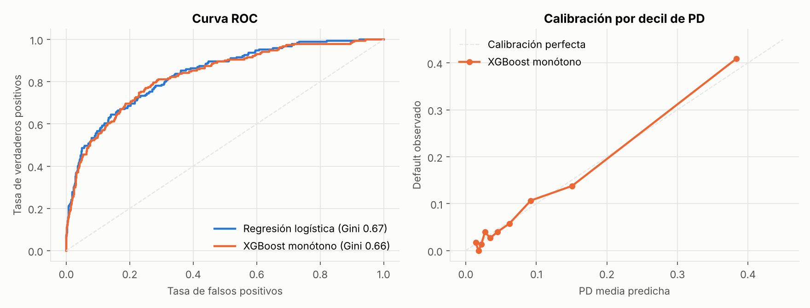
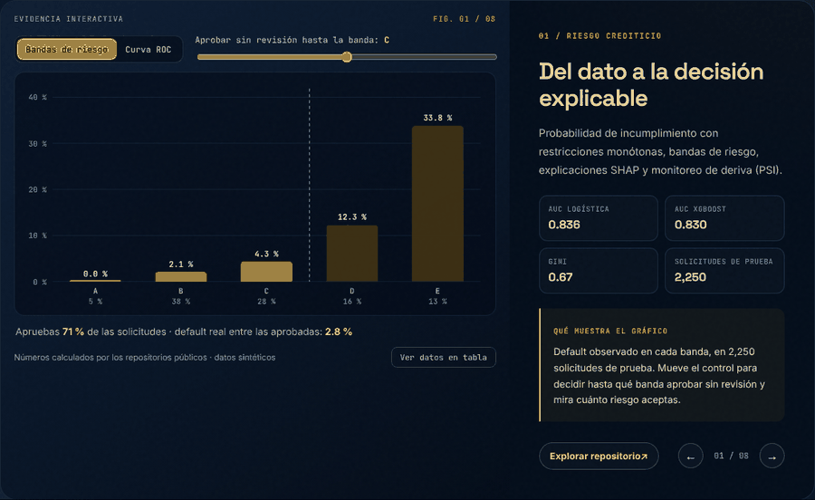
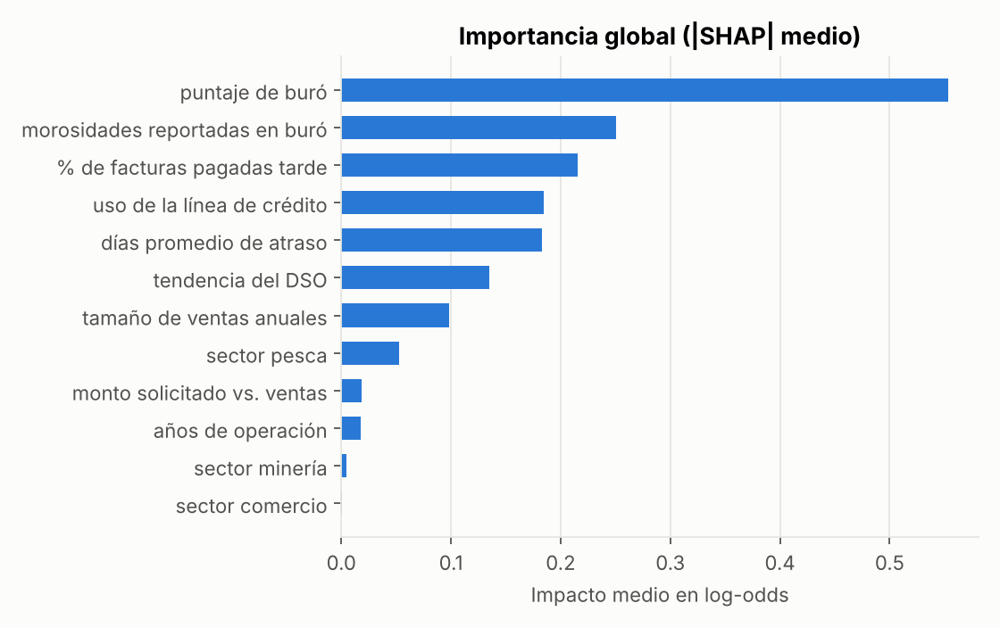
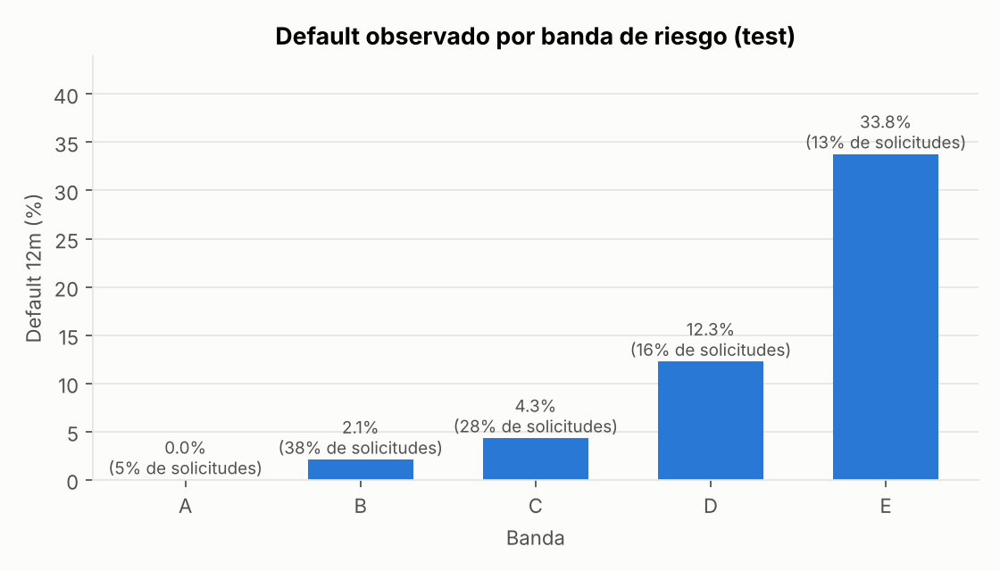
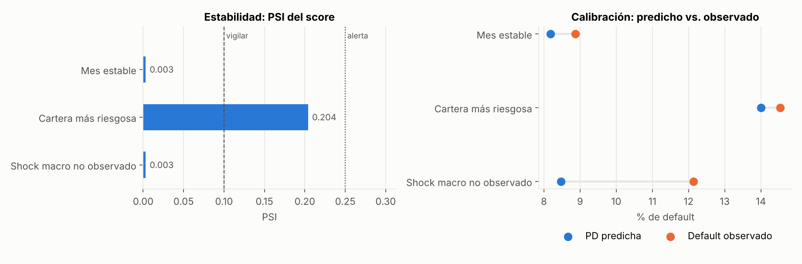

# Credit Risk Platform · Scoring de riesgo crediticio explicable + API

> **EN —** B2B credit-risk scoring: probability-of-default (PD) model with **monotonic constraints**, a points-based scorecard (PDO), risk bands with a decision policy and recommended limit, **SHAP reason codes** per applicant, a **FastAPI** service (Docker-ready) with automated tests, a **model card**, and **production monitoring** (PSI + calibration back-test). **All data is synthetic; no real customer or credit-bureau data is used.**



## Demo y capturas



> El mismo gráfico es **interactivo** en el [laboratorio de mi portafolio](https://dataross.vercel.app/#laboratorio): mueve los controles y se redibuja con los resultados de este repositorio.



*SHAP: qué variables pesan en cada decisión.*

## Problema de negocio

Aprobar una línea de crédito exige combinar comportamiento de pago interno, información de buró y
tamaño del cliente. La decisión debe ser **rápida, consistente y explicable**: si se rechaza o se reduce
un límite, el analista tiene que poder decir *por qué*.

## Qué hace

| Componente | Detalle |
|---|---|
| `data/generate.py` | 9,000 solicitudes **sintéticas** con default a 12 meses (8.5 %) |
| `models/scoring.py` | Regresión logística (benchmark) vs. **XGBoost con restricciones monótonas**, con early stopping |
| `utils/scorecard.py` | PD → puntaje (600 pts = odds 30:1; +20 pts duplica las odds), bandas A-E, decisión y límite recomendado |
| `models/explainability.py` | *Reason codes* con SHAP: los 3 factores que más mueven el riesgo de cada solicitud |
| `api/main.py` | API REST `POST /score` con validación de entrada (Pydantic) y `GET /health`; `Dockerfile` para desplegarla |
| `models/monitoring.py` + `monitor.py` | Monitoreo en producción: PSI del score y de cada variable, y back-test de default observado vs. PD predicha |
| `MODEL_CARD.md` | Ficha técnica, metodológica y funcional del modelo (propósito, datos, variables, desempeño, plan de monitoreo, limitaciones) |
| `tests/` | 21 pruebas: contrato de la API, entradas inválidas, monotonicidad, scorecard y PSI. Corren en cada *push* con GitHub Actions |

**¿Por qué restricciones monótonas?** En crédito, un modelo no puede decir que *más días de atraso
reducen el riesgo*, aunque el ruido de los datos lo sugiera. Las restricciones obligan a que el modelo
tenga sentido regulatorio y de negocio, y hay una prueba automática que lo verifica.

## Resultados (25 % de hold-out, datos sintéticos)

| Modelo | ROC-AUC | Gini | KS | Brier |
|---|---|---|---|---|
| Regresión logística | 0.836 | 0.672 | 0.503 | 0.061 |
| XGBoost monótono | 0.830 | 0.660 | 0.522 | 0.062 |

- Los dos modelos están prácticamente empatados. Es lo esperable: los datos se simularon con una relación logística. La API usa XGBoost monótono por sus restricciones y porque SHAP da explicaciones exactas para árboles. Con datos reales y no lineales esa ventaja suele crecer, pero **la regresión logística sigue siendo el benchmark** que hay que superar.
- **Las bandas ordenan el riesgo.** El default observado sube de 0 % en la banda A a 34 % en la E, y la PD predicha coincide con la observada en cada banda (buena calibración).



| Banda | % solicitudes | Default real | PD media | Decisión |
|---|---|---|---|---|
| A | 5 % | 0.0 % | 1.3 % | Aprobar |
| B | 38 % | 2.1 % | 2.2 % | Aprobar |
| C | 28 % | 4.3 % | 4.9 % | Aprobar con límite reducido (60 %) |
| D | 16 % | 12.3 % | 11.1 % | Revisión de analista |
| E | 13 % | 33.8 % | 33.1 % | Rechazar / pago adelantado |

## Monitoreo en producción

`python monitor.py` simula tres meses de solicitudes nuevas y aplica el tablero de monitoreo:



| Escenario | PSI del score | Calibración | Acción |
|---|---|---|---|
| Mes estable | 0.003 · estable | Calibrado | Ninguna |
| Cartera más riesgosa | 0.204 · vigilar | Calibrado | Revisar la estrategia de admisión; el modelo sigue bien |
| Shock macro no observado | 0.003 · estable | **Subestima** (PD 8.5 % vs. default 12.1 %) | Recalibrar el intercepto |

**La lección:** un shock que no está en las variables (por ejemplo, una recesión) deja el PSI "en verde"
mientras el modelo subestima el riesgo. Por eso el plan de monitoreo combina estabilidad **y**
back-test de calibración (ver `MODEL_CARD.md`).

## Usar la API

```bash
pip install -r requirements.txt
python train.py                      # entrena, evalúa, guarda artifacts/pd_model.joblib y figuras
python monitor.py                    # tablero de monitoreo (PSI + calibración)
uvicorn api.main:app --reload        # abre http://127.0.0.1:8000/docs
pytest -q

# o con Docker
docker build -t credit-risk-api .
docker run -p 8000:8000 credit-risk-api
```

```bash
curl -X POST http://127.0.0.1:8000/score -H "Content-Type: application/json" -d '{
  "sector": "Industria", "years_operating": 8, "annual_revenue": 1500000,
  "avg_days_late": 6, "pct_invoices_late": 0.12, "credit_utilization": 0.45,
  "bureau_score": 680, "bureau_delinquencies": 0, "dso_trend_days": 2, "requested_limit": 90000}'
```

Respuesta real del modelo entrenado:

```json
{
  "pd_12m": 0.0225, "score": 611, "banda": "B", "decision": "Aprobar",
  "limite_recomendado": 90000.0,
  "razones": [
    {"factor": "puntaje de buró", "valor": 680.0, "efecto": "reduce el riesgo", "impacto_log_odds": -0.645},
    {"factor": "% de facturas pagadas tarde", "valor": 0.12, "efecto": "reduce el riesgo", "impacto_log_odds": -0.237},
    {"factor": "morosidades reportadas en buró", "valor": 0.0, "efecto": "reduce el riesgo", "impacto_log_odds": -0.237}
  ]
}
```

## Estructura

```
credit-risk-platform/
├── data/          # generador sintético + CSV
├── models/
│   ├── scoring.py
│   ├── explainability.py
│   └── monitoring.py
├── api/           # FastAPI
├── utils/         # scorecard y política
├── tests/
├── artifacts/     # modelo entrenado (se regenera con train.py)
├── reports/
├── MODEL_CARD.md
├── Dockerfile
└── .github/workflows/tests.yml
```

## Limitaciones y siguientes pasos

- Falta validación fuera de tiempo (*out-of-time*) con cosechas reales; el monitoreo aquí usa escenarios simulados.
- Sería útil un análisis de *reject inference* y de umbrales por costo esperado (pérdida vs. margen).

---
**Rosy Napuchi** · Business Intelligence & Data Science · [Portafolio](https://dataross.vercel.app/)
